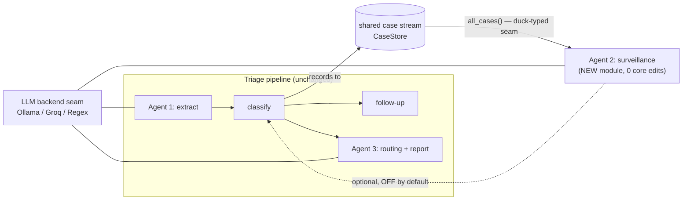

# Results & Evaluation — Redesign Plan

> **Purpose.** The concrete plan for the paper's Results/Evaluation section under
> the corrected framing (see [`PAPER_FRAMING.md`](PAPER_FRAMING.md)). It says what
> each result *shows*, the exact table/figure for it, **which existing harness
> produces it**, the current measured numbers, and what still needs building.
>
> Framing in one line: we are **not** proving medical accuracy — we are showing
> that a raw AI is unreliable for this task, that our **framework** measurably
> fixes that, that it adds a **new coordination mechanism** (active follow-up),
> and that it is **reusable / extensible**.
>
> Companion: [`PAPER_EVIDENCE.md`](PAPER_EVIDENCE.md) (current claims map),
> [`../CODEBASE_CONTEXT.md`](../CODEBASE_CONTEXT.md) (what the code does).
> All numbers below are the current tracked values; **regenerate with `--write`
> to confirm before quoting** (they can shift as the code changes).

---

## 0. The shift (old → new)

| | Old results | New results (this plan) |
|---|---|---|
| Claim | "our triage decisions are safe" | "a raw AI is unreliable; our framework fixes it, adds follow-up, and is reusable" |
| Discipline it reads as | clinical / statistical-ML | software engineering / design |
| Headline | "0% under-triage" (guaranteed by construction → not a finding) | the naive-AI failure + the failure→fix table |
| Heavy math | foregrounded (conformal proofs, calibration, AHP eigenvector) | appendix, as plain implementation notes |
| Dataset | implicitly treated as ground truth | explicitly a demonstration sandbox |

Almost all numbers are **reused** — repointed at a different question.

---

## 1. The five things the Results section shows

### Pillar 1 — Motivation: "you can't just prompt the AI"
**Claim it supports:** the framework is necessary; a single model is unsafe/unusable here.
**Harness:** `tests/evaluate_llm.py` (Part 1, LLM-only baseline on the same held-out cases).
**Figure/Table — R1:** LLM-only vs framework, one small table.

| system | misses urgent cases | over-calls mild cases | exact-tier accuracy | behaviour |
|---|---|---|---|---|
| LLM-only (`llama3.2:3b`) | 0.169 | 0.827 | 0.454 | collapses to "SEVERE" 251/304 |
| Framework (full) | ~0.0 (bounded) | 0.216 | — | abstains & asks when unsure |

**Framing note:** rename metrics to engineering terms in prose ("misses urgent" / "over-calls"), present the mode-collapse (251/304) as the vivid result. This is the opening punch.

### Pillar 2 — The framework fixes specific failures (the heart)
**Claim it supports:** each design decision removes a concrete failure of the naive approach.
**Harnesses:** `evaluate_oos.py` (component ablation), `evaluate_sensitivity.py` (the tunable safety knob), `evaluate_llm.py` Part 2 (extraction reliability), plus qualitative failures caught in code.

**Table R2a — Failure → design response → improvement (THE central table).** Each row is already real:

| Naive-AI failure (observed) | Design response in the framework | Measured effect |
|---|---|---|
| LLM mode-collapse → everything "SEVERE" | structured classifier + abstain gate | over-calls 0.827 → 0.216 |
| Never abstains / confidently wrong | uncertainty gate (abstain-and-ask) | confidently-wrong rate ↓ (from OOS records) |
| Fragile extraction — 1 schema bug discarded 13.3% of messages | schema repair + input grounding | failure 0.133 → 0.000; recall 0.800 → 1.000 |
| "mild fever" mis-read; one-word messages dropped | prompt + raw-text fallback | fixed (locked by tests) |
| Hallucinated diagnosis in the handoff (convulsing infant → "Cervical spondylosis / heating pad") | dataset-dx suppression gate | leak suppressed |
| Incoherent follow-up questions ("acute liver failure?") — 53.6% generic | askable-token constraint | generic 53.6% → 0% |
| Denials flatten the posterior → 28-disease "EMERGENCY" set | restrict absence evidence to the supported differential | can no longer escalate (tests) |

**Table R2b — Component ablation (what each layer contributes).** From `evaluate_oos.py`'s comparator grid:

| configuration | misses urgent | over-calls | notes |
|---|---|---|---|
| plain classifier, top-1 (no framework machinery) | 0.0915 | 0.068 | the naive structured baseline |
| + uncertainty set, no worst-case guard | 0.0634 | 0.068 | |
| + worst-case guard (full) | ~0.0 | 0.216 | the guard is what carries safety |
| + emergency boost | ~0.0 | 0.216 | **no effect → report as a negative result / candidate for removal** |

**Table R2c — The safety guard is a *tunable* property, not a lucky number.** From `evaluate_sensitivity.py` (α knob): the guarantee holds across the whole range, and **α = 0.01 dominates the current α = 0.10** (same safety, less over-calling, and removes the "return everything" fallback that fires 33.9% of the time at 0.10). → Recommend either shipping α = 0.01 or presenting α as an explicit design dial with this curve. Either way, **demote the "0% under-triage" line to a single sentence** ("the design gives a tunable safety guard"), not a headline.

### Pillar 3 — The new idea: active follow-up
**Claim it supports:** the original contribution — converting uncertainty into a targeted question and a better decision.
**Harness:** `tests/evaluate_followup.py`.
**Table R3:** selector vs simpler strategies, under two evidence models.

| scoring | policy | resolves uncertainty | mean questions | set size before → after |
|---|---|---|---|---|
| ignores "no" (old) | smart selector | 0.1942 | 2.71 | 4.33 → 3.30 |
| ignores "no" (old) | random | 0.2913 | 2.68 | 4.33 → 3.43 |
| counts "no" (shipped) | **smart selector** | **0.748** | **2.15** | **4.33 → 1.67** |
| counts "no" (shipped) | random | 0.583 | — | — |

**The story (keep it honest — reviewers love this):** the clever selector was *worse than random* until the classifier was taught to use "no"; once it does, the selector wins and resolves ~75% of uncertain cases in ~2 questions. Include the sub-finding that naively adding "no" first caused a pathology (a 28-disease false-alarm set), and the fix. This is the paper's most interesting moment.

### Pillar 4 — Reusability & extensibility (new; the §4 claim)
**Claim it supports:** this is a *framework* others can adopt and grow, not one app.
**Evidence (part architectural, part to-build):**
- **Describe the seams:** pluggable model backends, replaceable translation / routing providers, and the shared typed case→decision contract every module speaks.
- **Worked example — adding the surveillance module (Agent 2):** show it consumes the *same case stream* and plugs into a defined interface. (Currently not built — see §3.)
- **A "touch-count" measure:** how few call sites change to swap a backend or add a module (small, countable number → concrete evidence of low coupling).
**Table/Figure R4:** an architecture diagram with the extension points marked + a short "to add a module, you implement interface X and touch N places" box.

**Measured (now built):** Agent 2 (surveillance) is the worked example. It reads
the case stream through a duck-typed `all_cases()` interface and imports **none**
of the triage decision core (`app.rules_engine`) — enforced by
`tests/test_extensibility.py`. Touch-count to add it: a new `app/surveillance/`
package + one UI tab + one additive `case_store` column, **zero edits to the
triage decision path**. The model backend is a real swap point too (three
interchangeable `LLMBackend` implementations behind one interface).

The dotted arrow (Agent 2 → classify) is the optional, off-by-default feedback
loop — the bidirectional-coordination demonstration, kept behind a flag so the
core stays untouched.

### Pillar 5 — Practical & SDG impact (with vs without, in common-man terms)
**Claim it supports:** what the framework means for a real person and the SDGs,
not just internal metrics. **Harness:** `tests/evaluate_impact.py` (A/B/C).
**All demonstrated on the sandbox dataset; trip/cost figures are an explicitly
illustrative model, not field measurements.**

| | result (current) | with → without | SDG |
|---|---|---|---|
| **A · Access & cost** | 42% of messages → "care at home"; **80% of villages' *nearest* clinic can't handle an emergency** | without the tool: travel blindly / to a clinic that can't treat you | 3.8, 10 |
| **B · Language reach** | code-mixed lay token recall **0.962**; paraphrase agreement **0.75** | an English-only tool drops the non-English share entirely | 10, 3 |
| **C · Caller effort** | **~2.1** yes/no questions to a decision; resolves **75%** of uncertain cases | without follow-up: guess (unsafe) or a long form | 3.8 |

### Supporting (kept short — one paragraph / small table each)
- **Language robustness** (`evaluate_robustness.py`): same message repeated → identical decision (1.0); 3 real paraphrases → 0.75 agreement; reply handling — 0 misread, 0 hedges wrongly forced into an answer.
- **End-to-end through real text** (`evaluate_end_to_end.py`): text-in → tier-out survives code-mixed English/Hindi/Hinglish; token recall 0.962 on lay phrasings; the safety guard holds end-to-end.
- **Reliability / reproducibility** (`evaluate_llm.py` Part 2 + CI): deterministic output (1.0 at temperature 0), 600+ tests, deterministic harnesses, provenance doc.
- **Priority & routing behave correctly** (`evaluate_prioritization_routing.py`): the priority score orders within a tier (0.659 discrimination); routing matches the optimal choice (1.0) on the synthetic facility network. **One line each — these are the least AI-novel parts.**

---

## 2. What we demote or drop

| item | action | why |
|---|---|---|
| "never misses an emergency" headline | → one sentence ("tunable safety guard") | guaranteed by construction; can't be the climax |
| conformal-prediction theory, coverage proofs | → appendix, plain-language | it's an implementation choice, not the contribution |
| calibration error (ECE/Brier), AHP eigenvector/consistency math | → appendix or cut | reads as a math/ML paper |
| in-sample perfect scores (F1 = 1.00) | stays cut | measures training data, not the system |
| medical-sounding metric names | rename to engineering terms | avoids the "medical claim" drift |
| the emergency-boost constant | report as a negative result | ablation shows it does nothing |

---

## 3. Build status (Bucket 3 — DONE)

1. **Composed ablation figure** — ✅ `tests/evaluate_composed.py`. Measured:
   misses-urgent **0.169 → 0.092 → 0.063 → 0.000 → 0.021** across
   `LLM-only → NB → abstain → worst-case → follow-up`; over-calls
   **0.827 → … → 0.216 → 0.056**. The one-table journey.
2. **Surveillance agent (Agent 2)** — ✅ `app/surveillance/` + the 🏛️ Official
   UI tab. Light-stats detection, "alert only when out of hand" policy, LLM
   brief fired only on alerts, recommended action, watchlist, optional
   (off-by-default) feedback loop. On the demo stream it raises exactly the
   injected outbreak; a flat stream raises nothing.
3. **Extensibility evidence** — ✅ `tests/test_extensibility.py` + the diagram
   above. Agent 2 never imports the triage core; backends are a real swap point.
4. **Systems cost** — ✅ `tests/evaluate_cost.py`. One unavoidable LLM call
   (extraction, ~4 s); every other call conditional; deterministic stages
   sub-millisecond-to-tens-of-ms. The framework adds near-zero compute over the
   single LLM call.
5. **Practical/SDG impact (A/B/C)** — ✅ `tests/evaluate_impact.py` (Pillar 5).

---

## 4. Proposed paper Results section (section order)

- **R1 Motivation** — the naive-AI baseline (Pillar 1).
- **R2 The framework** — failure→fix table (R2a) + component ablation (R2b) + the tunable guard (R2c) (Pillar 2).
- **R3 Active follow-up** — the loop and the honest selector-vs-random finding (Pillar 3).
- **R4 Reusability & extensibility** — seams + the surveillance-module walkthrough (Pillar 4).
- **R5 Supporting** — robustness, end-to-end, reliability/reproducibility, priority/routing (one each).
- **R6 Scope & limitations** — demonstration dataset, POC not deployment, no user study; named as future work.

## 5. Quick map: paper element → harness → status

| paper element | harness | status |
|---|---|---|
| R1 naive-AI baseline | `evaluate_llm.py` | ✅ have numbers |
| R2a failure→fix table | code + `evaluate_llm.py` Part 2 | ✅ assemble from existing findings |
| R2b component ablation | `evaluate_oos.py` | ✅ have numbers |
| R2c tunable guard | `evaluate_sensitivity.py` | ✅ have numbers; decide α |
| R3 follow-up loop | `evaluate_followup.py` | ✅ have numbers |
| R4 extensibility | `app/surveillance/` + `test_extensibility.py` | ✅ built |
| R5 robustness / end-to-end / routing | `evaluate_robustness.py`, `evaluate_end_to_end.py`, `evaluate_prioritization_routing.py` | ✅ have numbers |
| Pillar 5 practical/SDG (A/B/C) | `evaluate_impact.py` | ✅ built |
| composed ablation figure | `evaluate_composed.py` | ✅ built |
| systems cost | `evaluate_cost.py` | ✅ built |
| Agent 2 surveillance | `app/surveillance/` + 🏛️ Official UI tab | ✅ built |

---

**Bottom line:** the Results section is mostly a **re-organization and re-labelling** of evidence that already exists, plus four small build items (composed figure, surveillance skeleton, extensibility measure, systems cost). The through-line is the framing doc's four pillars — nothing here claims medical accuracy or leads with statistics.
