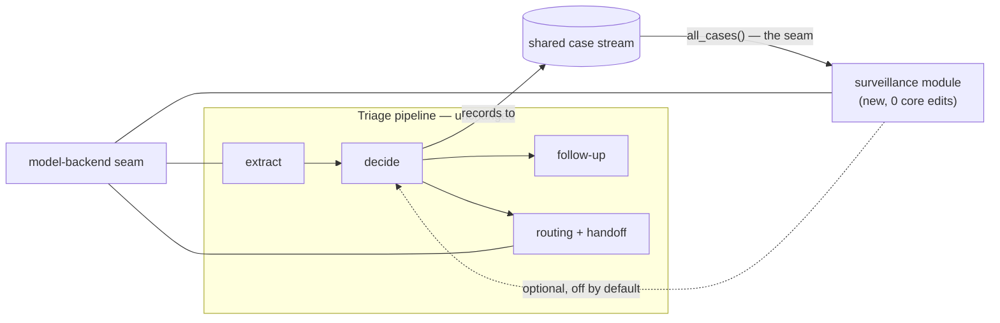

# Results & Evaluation

> **Standalone summary — safe to share.** Every figure here is read from the
> tracked result files in `triage-poc/tests/eval_*_results.json` and regenerates
> with one command (§0.4). Positioning follows
> [`PAPER_FRAMING.md`](PAPER_FRAMING.md); the section order follows
> [`EVALUATION_REDESIGN.md`](EVALUATION_REDESIGN.md).

---

## 0. What is being evaluated, and how

### 0.1 The system in one paragraph

A framework for **message-based health triage** in low-resource settings. A
person describes symptoms in their own words (English, Hindi, or a mix); the
system converts that into a structured record, decides how urgently they need
care, **asks a targeted yes/no question when it is unsure**, and points them to
an appropriate facility. The contribution is the **coordination between those
parts** — not a new model and not a medical claim.

### 0.2 What we are and are not showing

| | |
|---|---|
| **We show** | a raw AI model is unreliable for this task; the framework measurably fixes specific failures; a new coordination mechanism (active follow-up); and that the design is reusable/extensible |
| **We do not show** | clinical or diagnostic accuracy; a new ML model; that the dataset represents real patients |

### 0.3 Setup

- **Demonstration dataset** (a sandbox, *not* clinical ground truth): 41
  conditions, 131 symptom tokens, collapsing to **304 unique symptom profiles**.
- **Protocol:** leave-profiles-out **5-fold** cross-validation. Each held-out
  profile is cut to a random **2–4 symptom** subset — the realistic condition
  where someone mentions a few symptoms, not a complete record.
- **Model:** a local `llama3.2:3b` via Ollama.
- **Test suite:** 627 passed, 1 xfailed, 1 xpassed.

### 0.4 Reproducing

```bash
cd triage-poc
PYTHONPATH=. python tests/evaluate_composed.py               # R2b  the journey table
PYTHONPATH=. python tests/evaluate_llm.py                    # R1   naive baseline + reliability
PYTHONPATH=. python tests/evaluate_oos.py                    # R2b  component ablation
PYTHONPATH=. python tests/evaluate_sensitivity.py            # R2c  the tunable dial
PYTHONPATH=. python tests/evaluate_followup.py               # R3   active follow-up
PYTHONPATH=. python tests/evaluate_impact.py                 # R5   practical / SDG
PYTHONPATH=. python tests/evaluate_end_to_end.py             # R6   text-in → decision-out
PYTHONPATH=. python tests/evaluate_robustness.py             # R6   language + replies
PYTHONPATH=. python tests/evaluate_prioritization_routing.py # R6   priority + routing
PYTHONPATH=. python tests/evaluate_cost.py                   # R6   systems cost
```

Add `--write` to refresh a tracked baseline. The deterministic harnesses
reproduce **byte-for-byte**; the three that call the model are reproducible up
to the model's own determinism, which is itself measured at 1.000 (§R6.3).

### 0.5 Reading the two main numbers

Two rates are used throughout. They are **engineering properties of how the
pipeline handles its own uncertainty**, measured against the sandbox dataset's
labels — not clinical judgements.

| term | meaning |
|---|---|
| **misses urgent** | a case whose dataset label is urgent was surfaced at a lower level (n = 142) |
| **over-calls** | a case whose dataset label is routine was surfaced at a higher level (n = 162) |

---

## R1 · Motivation — prompting the model directly does not work

**Question:** is a framework needed at all, or would prompting the model do?

The same `llama3.2:3b` is given the **same 304 held-out cases**, the same
symptoms, and a prompt that states the four levels *and* the instruction "when
uncertain, choose the more severe." It is not a strawman.

### Table R1 — single model vs. the framework

| system | misses urgent ↓ | over-calls ↓ | exact-level accuracy | behaviour |
|---|---|---|---|---|
| **LLM-only** (`llama3.2:3b`) | **0.169** (24/142) | **0.827** | 0.454 | collapses to one answer |
| **Framework** (full) | **0.000** | 0.216 | — | abstains and asks when unsure |

**The vivid result:** of 304 replies, **251 were "SEVERE"** (plus 36 MODERATE,
11 MILD, 6 EMERGENCY). The model is simultaneously *unsafe* (misses 16.9% of
urgent cases) and *uninformative* (over-calls 82.7% of routine ones), because
it is barely discriminating at all. Output formatting was never the problem —
0 invalid replies in 304 calls.

> **Takeaway.** Safety instructions written into a prompt do not produce a
> dependable decision. The structure around the model is what does.

---

## R2 · The framework fixes specific failures

### R2a — Failure → design response → measured effect (the central table)

Every row is an observed failure, a design decision made in response, and the
measured outcome.

| Observed failure of the naive approach | Design response | Measured effect |
|---|---|---|
| Model collapses to one answer for everything | structured classifier + abstain gate | over-calls **0.827 → 0.216** |
| Never abstains; confidently wrong | uncertainty gate (abstain-and-ask) | confidently-wrong rate **0.000**; 33.9% of cases routed to "ask" instead of guess |
| One schema defect silently discarded whole messages | schema repair at the boundary | extraction failure **0.133 → 0.000**; recall **0.800 → 1.000** |
| "mild fever" mis-read as "fever"; one-word messages dropped entirely | prompt contract + raw-text fallback with a strict confidence gate | fixed; locked by tests |
| Hallucinated diagnosis in the clinician handoff (a convulsing infant produced "Cervical spondylosis / heating pad") | suppress dataset diagnosis on paths where it is not the basis of the decision | leak suppressed |
| Follow-up asked unanswerable questions ("…acute liver failure?", "…coma?"); 53.6% fell back to generic phrasing | restrict questions to caller-answerable symptoms + full phrasing coverage | generic phrasing **53.6% → 0%**; unanswerable questions **→ 0** |
| Counting "no" answers naively flattened the decision and produced a 28-condition false alarm | restrict negative evidence to the differential the positive evidence supports | can no longer escalate; asserted by tests |

### R2b — The journey: one metric across the whole stack

Each row adds **one layer** to the row above it, scored on the same held-out
cases. This is the single clearest picture of what the framework buys.

| stage | configuration | misses urgent ↓ | over-calls ↓ |
|---|---|---|---|
| **C0** | LLM-only (prompt the model) | 0.1690 | 0.8272 |
| **C1** | + structured classifier (top-1) | 0.0915 | 0.0679 |
| **C2** | + abstain gate | 0.0634 | 0.0679 |
| **C3** | + worst-case guard (full system) | **0.0000** | 0.2160 |
| **C4** | + active follow-up (shipped) | 0.0211 | **0.0556** |

Read left to right: structure removes most of the naive model's failure (C0→C1);
the abstain gate removes more (C1→C2); the worst-case guard removes the rest at
the cost of caution (C2→C3); and **active follow-up then buys most of that
caution back** — over-calls fall 0.216 → 0.056 while misses stay within the
designed bound (C3→C4).

### Table R2b-ii — Component ablation (which layer is load-bearing)

| configuration | misses urgent | over-calls | answers confidently |
|---|---|---|---|
| plain classifier, top-1 — no framework machinery | 0.0915 | 0.0679 | 100% |
| + uncertainty set, **no** worst-case guard | 0.0634 | 0.0679 | 66.1% |
| + worst-case guard (**full system**) | **0.0000** | 0.2160 | 66.1% |
| − emergency-boost constant (ablated) | 0.0000 | 0.2160 | 65.8% |

Two findings:
- **The worst-case guard is what carries the result.** Removing only that layer
  takes misses from 0.000 to 0.063.
- **Negative result, reported as such:** removing the emergency-boost constant
  changes nothing. Swept from 1.0 to 10.0 with the gate re-fitted at each value,
  it never reduces misses and at higher values slightly *increases* over-calls.
  It is not load-bearing and is a candidate for deletion.

### R2c — The safety guard is a tunable dial, not a lucky number

The guard has one parameter, α. Sweeping it shows the behaviour is a designed
trade-off that holds across the whole range, rather than a single tuned point.

| α | internal threshold | misses urgent | over-calls | answers confidently | falls back to "return everything" |
|---|---|---|---|---|---|
| 0.01 | 0.9682 | 0.0000 | 0.1728 | 0.6908 | **0.000** |
| 0.02 | 0.8940 | 0.0070 | 0.1420 | 0.7434 | 0.000 |
| 0.05 | 0.5424 | 0.0282 | 0.1235 | 0.8125 | 0.135 |
| **0.10 (shipped)** | 0.0216 | 0.0000 | 0.2160 | 0.6612 | **0.339** |
| 0.15 | 0.0102 | 0.0000 | 0.2346 | 0.6118 | 0.388 |
| 0.20 / 0.30 | 0.0000 | 0.0000 | 0.2654 | 0.5822 | 0.418 |

**Two things disclosed rather than hidden:**

1. **"Misses urgent = 0.000" is a property of the design, not a discovery.**
   When the system is unsure it reports the most serious possibility in its
   candidate set, so it cannot land below the truth whenever the truth is in
   that set. It is therefore a *bounded guarantee* (≤ α), and the sweep confirms
   the bound holds at every setting. It should be one sentence in the paper, not
   the headline.
2. **At the shipped α = 0.10 the system falls back to "return every candidate"
   on 33.9% of cases.** Those decisions come from that fallback plus the
   worst-case guard, not from the uncertainty gate proper. α = 0.01 removes the
   fallback entirely and reduces over-calls — but only by making the gate far
   more permissive (threshold 0.0216 → 0.9682). Both settings are published so a
   reader can choose; α = 0.10 is retained as the conventional value.

---

## R3 · The new idea — active follow-up

When the system cannot decide, it asks **one targeted yes/no question**, then
decides again (up to 3 questions).

**How this is evaluated without inventing data:** each held-out case is a real
profile from the dataset with a known, complete symptom list. The caller is
shown only a 2–4 symptom subset. When the system asks "does the patient have
X?", the answer is **read off that same real profile**. Nothing is generated.

### Table R3 — question-selection strategy × how answers are used

| how answers are used | question strategy | resolves uncertainty | mean questions | candidates before → after | resolved correctly | over-calls |
|---|---|---|---|---|---|---|
| ignores "no" *(old)* | smart selector | 0.1942 | 2.71 | 4.33 → 3.30 | 0.1942 | 0.2160 |
| ignores "no" *(old)* | most-frequent | 0.0971 | 2.97 | 4.33 → 3.37 | 0.0583 | 0.1914 |
| ignores "no" *(old)* | **random** | **0.2913** | 2.68 | 4.33 → 3.43 | 0.2718 | 0.1420 |
| **counts "no"** *(shipped)* | **smart selector** | **0.7476** | **2.15** | **4.33 → 1.67** | **0.6699** | **0.0556** |
| counts "no" *(shipped)* | most-frequent | 0.4272 | 2.62 | 4.33 → 1.97 | 0.3398 | 0.1049 |
| counts "no" *(shipped)* | random | 0.5825 | 2.45 | 4.33 → 1.94 | 0.5437 | 0.0864 |

### The story — a two-part finding worth telling honestly

1. **The clever selector was worse than random** (0.194 vs 0.291). The reason is
   a design inconsistency: the selector chooses questions by how much
   information *either* answer would give — it reasons about "no" as much as
   "yes" — but the decision component only ever used "yes". Half the information
   each question was chosen to obtain was thrown away.
2. **Teach the system to use "no", and the selector wins.** Resolution rises
   **0.194 → 0.748** (3.9×), questions fall to ~2.1, and the selector now beats
   both random (0.583) and most-frequent (0.427).

**A pathology found while implementing the fix.** The obvious way to count "no"
answers — letting a denial count against every condition — made things *worse*
in a dangerous way: denying three symptoms on a cough case produced a
**28-condition** candidate set including unrelated serious conditions, which the
worst-case guard then escalated to the top urgency level. Denials made the
system *less* certain and *more* alarmed. The fix restricts negative evidence to
the conditions the positive evidence already supports, so a "no" can only narrow
the picture, never widen it. It also improved the numbers (0.718 → 0.748) and is
locked by tests. *Worth reporting: the naive version's aggregate numbers looked
fine — only a deliberate monotonicity check exposed it.*

**Net effect of the loop:** over-calls **0.216 → 0.056**, at the cost of
0.021 misses (within the designed bound), with the correct answer retained in
the candidate set 97.4% of the time.

---

## R4 · Reusability & extensibility

The claim that this is a *framework* rather than one application is evidenced
structurally, not asserted.

### Extension points the design exposes

| seam | what can be swapped |
|---|---|
| **Model backend** | three interchangeable implementations behind one interface (local LLM / hosted / rules-based stand-in) |
| **Translation provider** | behind an interface, with a no-op default |
| **Routing provider** | behind an interface, with an offline default |
| **Shared case contract** | one typed record every module reads and writes |

### Worked example — adding a second module with zero core edits

An **outbreak-surveillance module** was added as the test of the claim. It
watches the stream of recorded cases for unusual clusters in an area.

| property | measured |
|---|---|
| Size | 11 modules, 789 lines |
| Edits to the triage decision path | **0** |
| How it reads data | duck-typed `all_cases()` — it does not even hard-import the store |
| Imports of the decision core | **none** (enforced by an AST test, not a convention) |
| Other changes needed | one new UI tab + one additive, nullable database column |



### Does the new module work?

| stream | cases | alerts raised |
|---|---|---|
| Stream with an injected outbreak | 132 | **1** — exactly the injected one, with a recommended action |
| Flat stream, no outbreak | 120 | **0** — stays silent |

The model is called **only when an alert fires**, never per case, and falls back
to a deterministic summary when unavailable.

> **Takeaway.** A second capability was added to the framework without touching
> the decision pipeline, reusing the existing case contract through a defined
> seam — which is what distinguishes a framework from an application.

---

## R5 · Practical and SDG impact

Demonstrated on the sandbox dataset. **Trip and cost figures are an explicitly
illustrative model with stated assumptions, not field measurements.**

| | result | without the framework | SDG |
|---|---|---|---|
| **A · Access & cost** | **42.1%** of messages resolve to "care at home"; for urgent cases the **naive nearest clinic is unsuitable in 80%** of villages | travel blindly, or to a facility that cannot treat you | 3.8, 10 |
| **B · Language reach** | code-mixed lay recall **0.962**; same-meaning rephrasings agree **0.75**; replies misread **0.000** | an English-only tool drops the non-English share entirely | 10, 3 |
| **C · Caller effort** | **~2.1** yes/no questions to a decision; resolves **74.8%** of unclear cases | be guessed at, or fill a long form | 3.8 |

Illustrative model (assumption stated in the output: 1 avoided trip ≈ 4 hours
and ≈ ₹300): per 1,000 callers → **421 avoided trips, 1,684 hours, ₹126,316**.

---

## R6 · Supporting results

### R6.1 End-to-end — real text in, decision out

The only measurement covering the **whole composed pipeline**, including the
language stages. The same cases are scored twice — once on ground-truth symptoms,
once on symptoms actually recovered from text — so the difference is attributable
to the language layer alone.

| rendering | n | symptom recall | exact match | misses urgent | agreement with ground-truth-symptom run | cost of the language layer |
|---|---|---|---|---|---|---|
| plain English (ceiling) | 304 | 0.993 | 0.980 | **0.000** | 0.997 | −0.006 over-calls |
| **real code-mixed lay language** | 83 | **0.962** | 0.892 | **0.000** | **0.976** | **+0.053 over-calls** |

In the lay condition every symptom is replaced by a genuine caregiver phrasing
from the project's pre-existing labelled set, rotated across English, Hindi
(Devanagari) and Hinglish, so each message is truly code-mixed.

> **Caveat to read with it.** The lay subsample is chosen by which symptoms have
> labelled phrasings, not at random, so its *absolute* over-call rate (0.842) is
> not comparable to the full set — the ground-truth-symptom run on those same 83
> rows is already 0.789. Compare the **delta**, not the absolute.

### R6.2 Robustness to how the message is written

| property | result |
|---|---|
| Same message submitted 3× → same decision | **1.000** |
| 3 different real phrasings of the same content → same decision | **0.750** |
| Different subset of the same person's symptoms → same decision | 0.866 (277 cases) |
| Replies not understood (37 forms incl. Hindi/Hinglish) | **0.000** |
| Replies read as the *opposite* answer | **0.000** |
| Vague replies ("maybe", "pata nahi") wrongly forced into an answer | **0.000** |

Repeat and rephrasing are reported separately on purpose: the first measures
model non-determinism, the second is the actual language claim. Refusing to
interpret a vague reply is a deliberate safety property — the system re-asks
instead of inventing an answer.

### R6.3 Reliability and reproducibility

| property | result |
|---|---|
| Valid output format | 100% (0 invalid in 304 calls) |
| Determinism at temperature 0 | **1.000** |
| Structured-extraction success | **1.000** (was 0.867) |
| Expected-symptom recall | **1.000** (was 0.800) |
| Test suite | 627 passed, 1 xfailed, 1 xpassed |
| Deterministic harnesses | reproduce byte-for-byte |

### R6.4 Systems cost

| | |
|---|---|
| Model calls, typical routine case | **1** (extraction only) |
| Model calls, typical urgent case | 2 (extraction + handoff summary) |
| Follow-up phrasing | 0–3, only when unsure |
| Surveillance summary | event-driven, only when an alert fires |
| Decision stage (deterministic) | ~55 ms |
| Routing (deterministic) | ~0.06 ms |
| Surveillance pass (deterministic) | ~0.23 ms |
| Extraction (model) | ~3,800 ms |

The framework's own logic is **negligible** beside the single unavoidable model
call. Everything the framework adds is either deterministic and sub-second or
conditional on uncertainty. *(Latencies are machine-dependent — compare stages,
not absolutes.)*

### R6.5 Prioritisation and routing behave correctly

| | result |
|---|---|
| Priority score distinguishes patients at the same level | 0.659 of same-level pairs ordered (1,025 cases) |
| Critical sign always forces top priority | yes |
| Routing matches an exhaustive best-choice search | **1.000** (10 scenarios) |
| Urgent cases only sent to capable facilities | **1.000** |
| Opening hours respected | **1.000** |
| Travel time, mean / max | 12.0 / 36.8 min |

These are the least novel parts of the system; they are reported for
completeness. No clinical-correctness claim is made for the priority score, and
the facility network is a 10-facility synthetic demonstration set.

---

## R7 · Scope and limitations

Stated plainly rather than discovered by a reader.

1. **Demonstration dataset, not clinical ground truth.** 41 conditions from a
   public teaching dataset. Urgency labels were **assigned by the authors**; no
   clinician reviewed them. Every rate above is *relative to those labels* —
   evidence about the framework's internal behaviour, not medical validity.
2. **The sandbox is easier than reality.** Symptom–condition associations in it
   are effectively binary (100% of associations hold in ≥70% of a condition's
   records, none below). Real associations are probabilistic, so the follow-up
   figures should not be extrapolated.
3. **Only 2 conditions carry the top urgency label**, so the urgent group is
   dominated by the second tier.
4. **No user study and no field deployment.** No real caller has used this.
5. **The children's pathway is not evaluated.** It needs physical-examination
   findings that cannot come from a text message; it is a faithful rule-based
   implementation of published guidance, held out of scope.
6. **Once follow-up answers are used, the guard's bound becomes approximate**
   rather than exact. Checked empirically (0.021 ≤ 0.10) rather than assumed.
7. **A single local model** (`llama3.2:3b`) was used; results may differ with
   another model.

All are named as future work: clinical validation, real-world data, a user
study with health workers, and a larger labelled set of lay phrasings.

---

## Appendix — implementation notes kept out of the main text

Deliberately not foregrounded, since they are implementation choices rather than
the contribution: the uncertainty gate is split conformal prediction (LAC) over
a Naive Bayes posterior, with α as the dial in R2c; negative evidence uses a
Laplace-smoothed Bernoulli absence term restricted to the supported candidate
set; the priority score is an AHP weighted sum whose weights, λmax and
consistency ratio (0.0198) are **computed from the pairwise matrix at import**
rather than hard-coded, with the matrix the only elicited input.

Full data provenance, including which values are author-assigned expert
judgement, is in [`../triage-poc/data/PROVENANCE.md`](../triage-poc/data/PROVENANCE.md).
